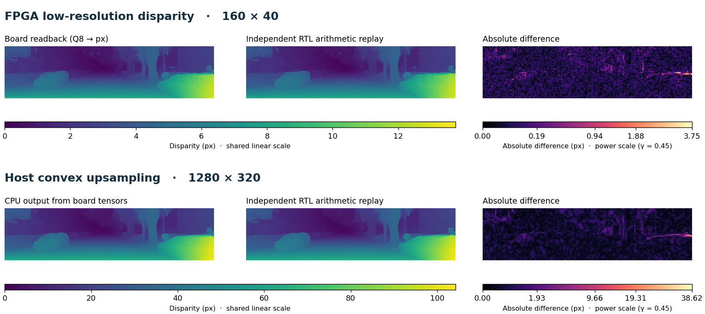
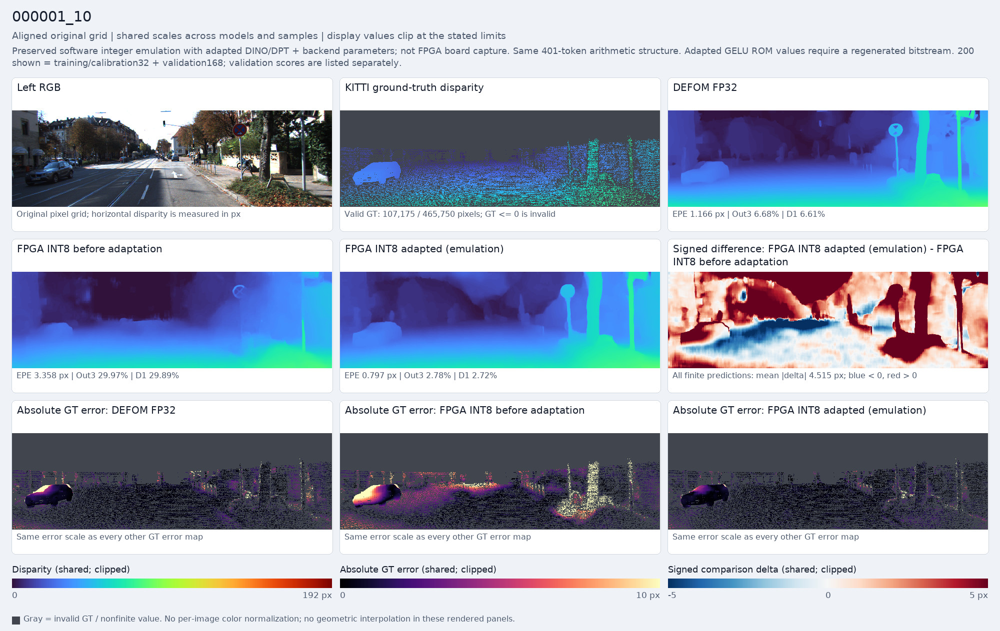
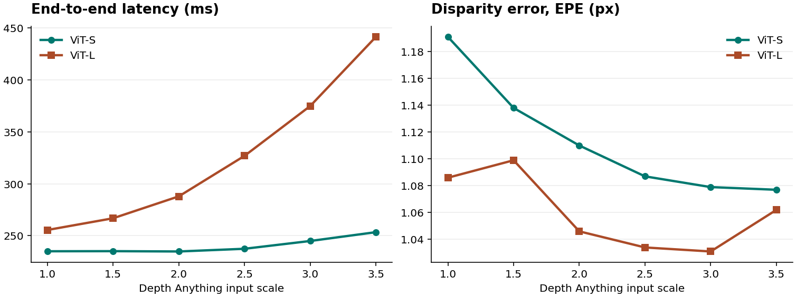

# DEFOM-Stereo · FPGA 시차 추정과 GPU 분석

**2026 · 이상욱**  
좌우 카메라 영상에서 물체까지의 거리를 추정하려면 같은 지점이 두 영상에서 얼마나 어긋나는지, 즉 시차를 구해야 한다. 이 프로젝트에서는 DEFOM-Stereo의 전단과 후단 연산을 FPGA에 옮겨 실제 보드가 반환한 시차를 검증했다. GPU에서는 깊이 인코더의 입력 크기와 INT8 보정이 속도와 오차에 미치는 영향을 비교했다.

## FPGA에서 실행한 DEFOM-Stereo

직접 개발한 **401토큰 ViT**로 좌우 영상을 차례로 처리하고, DPT와 후단 시차 갱신을 NPU 4개에서 실행했다. 2026년 10월 29일 14:03 실행에서 같은 좌우 영상 한 쌍을 세 번 측정했다. **세 번 모두 최종 시차 검사를 통과했고, 한 쌍의 최단 전체 추론 시간은 2.809116초**였다.

| 실보드 측정 | 1회 | 2회 | 3회 |
| --- | ---: | ---: | ---: |
| 좌우 영상 한 쌍의 전체 추론 (ms) | **2,809.116** | 2,847.427 | 2,823.743 |
| 사후 수치 검사 | PASS | PASS | PASS |

전단 시작부터 PC에서 최종 시차를 복원할 때까지 측정했다. 1회차의 전체 시간에는 좌우 ViT, 보드와 PC 사이의 전송, 첫 상관 볼륨 계산, FPGA의 시차 갱신 32회(2,035.940 ms), PC의 최종 업샘플링이 포함된다. 가중치·명령 사전 적재, 워밍업, 회차별 사후 비교는 측정 구간 밖이다.

[실행 기록과 측정 구간](docs/fpga-board-runs.md) · [실험 요약 PDF](docs/defom-project-brief.pdf)

<details>
<summary>별도 실험에서 읽은 보드 시차와 재현 코드 (10월 30일)</summary>



위 그림은 10월 30일 진단 실행에서 읽은 40 × 160 시차와 같은 실행의 마스크로 복원한 320 × 1,280 시차다. 이 진단 실행의 최종 시차는 수치 참조와 차이가 있었다. [보드 출력 배열](results/board-sample.npz) · [4개 NPU 실행 제어 코드](board/chip4_control.py)

</details>

## KITTI에서 비교한 소프트웨어 예측



**그림을 읽는 법** · 첫 줄은 왼쪽 영상, KITTI 정답, FP32 예측이다. 둘째 줄에서는 INT8 조정 전·후 결과를, 마지막 줄에서는 정답과의 절대 오차를 비교한다. 오차 지도에서 회색은 유효한 정답이 없는 픽셀이다. 이 장면의 평균 시차 오차는 INT8 조정 전 **3.358 px**, 조정 후 **0.797 px**였다. 예측은 하드웨어 산술을 소프트웨어에서 모사해 얻었다. [그림 출처와 사용 조건](docs/experiments.md#sources)

[KITTI 실행 환경과 측정 조건](docs/experiments.md)

## 깊이 인코더 입력을 어디까지 줄일 수 있을까?

KITTI 2015 영상에서 Depth Anything의 입력 배율을 1.0–3.5로 바꿔 ViT-S와 ViT-L을 각각 측정했다. **ViT-S**에서는 배율을 3.5에서 2.0으로 내리자 전체 추론 시간이 **253.4 → 234.8 ms**, 평균 시차 오차(EPE)는 **1.077 → 1.110 px**가 됐다. 배율을 1.0까지 더 낮춰도 전체 시간은 235.0 ms였고 오차는 1.191 px로 커졌다. 같은 변경에 대한 **ViT-L**의 전체 시간은 441.5 → 287.9 ms였다.



발표의 입력 크기 표기는 370×1224이며 혼합 정밀도는 껐다. 그래프의 시간은 전체 모델을 한 번 실행한 값들의 평균이다. [12개 조건의 측정값](results/kitti15-resize-sweep.csv) · [GPU 프로파일링 코드](evaluate_kitti_profile.py)

## INT8로 바꾼 뒤의 시차 오차

전단의 양자화 파라미터를 다시 보정하고 후단을 미세학습했다. KITTI 2015 학습 분할의 200쌍 중 이번 보정·미세학습에 사용한 32쌍을 제외하고, 동일한 **168쌍**에서 세 구성을 비교했다. 이전 전단 최적화에서도 KITTI를 사용했으므로 이 수치의 범위는 해당 장면들이다.

| 소프트웨어 예측 | 평균 시차 오차 EPE (px) ↓ | Out3 (%) ↓ | D1 (%) ↓ |
| --- | ---: | ---: | ---: |
| 기준 DEFOM FP32 | 1.3233 | 7.4102 | 7.2303 |
| 조정 전 INT8 | 3.8179 | 28.0948 | 28.0233 |
| 조정 후 INT8 | **1.2104** | **4.8217** | **4.6038** |

EPE는 장면별 평균에 같은 가중치를 줬다. Out3와 D1은 유효한 정답 픽셀 15,358,905개를 기준으로 계산했다. [장면별 결과](results/kitti-int8-per-image.csv) · [집계 코드](scripts/summarize_int8.py)

## 블록 단위 진단 코드

- **Correlation lookup RTL** · 첫 delta update의 한 픽셀에서 두 피라미드 레벨의 데이터를 보간하고 INT8로 다시 양자화했다. 유효 채널 18개와 패딩 46바이트를 다시 계산하면 이전 Vivado XSim이 기록한 128비트 출력 네 개와 일치한다. 채널 9에서 이전 참조값 20과 RTL 산술 결과 21이 갈린 지점도 확인할 수 있다. [Verilog 소스·테스트벤치·입력 벡터](hardware/README.md)
- **DINO 인코더** · VCU128용 호스트 코드는 PCIe로 패치 임베딩과 첫 인코더 블록의 Q·V·최종 출력을 읽어 참조값과 비교한다. 이 코드는 한 블록의 검증 범위를 보여준다. [보드 검증 코드](board/dino_block_check.py) · [보드 실행 조건](docs/experiments.md#board)

## 바로 확인하기

아래 명령으로 10월 26일의 NPU 채널 배분, 10월 30일의 보드 시차와 호스트 출력을 다시 확인할 수 있다. 보드 배열을 읽는 두 명령은 NumPy가 필요하다.

```sh
python board/verify_conv_schedule.py
python scripts/verify_board_readback.py
python board/replay_upsample.py
```

기반 모델은 CVPR 2025의 *DEFOM-Stereo: Depth Foundation Model Based Stereo Matching*이다. [원 논문](https://arxiv.org/abs/2501.09466) · [원 모델 구현](https://github.com/antigravity-tech/DEFOM-Stereo) · [KITTI Stereo 2015](https://www.cvlibs.net/datasets/kitti/eval_scene_flow.php?benchmark=stereo)
