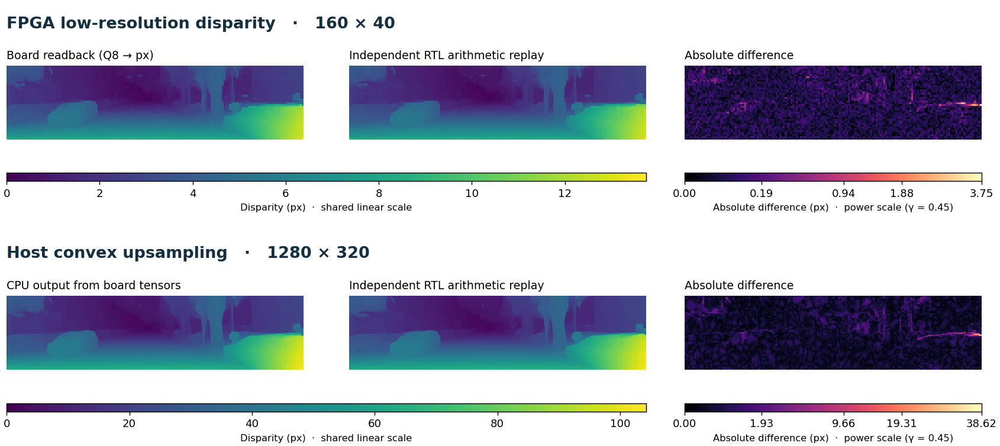

# DEFOM-Stereo 실보드 실행 기록

## 10월 29일 14:03 · 401토큰 ViT + 4 NPU 전체 추론

직접 설계한 401토큰 ViT 한 개로 왼쪽과 오른쪽 영상을 차례로 처리했다. NPU 4개로 DPT, 초기 CNet/FNet, 스케일 갱신 8회(SU)와 시차 변화량 갱신 24회(DU)를 실행했다. 타일 생략과 조기 종료를 끄고 같은 좌우 영상 한 쌍을 세 번 처리했다. 세 번 모두 전단 출력, 초기 시차와 최종 시차를 포함한 사후 수치 검사를 통과했다. **가장 빠른 회차는 1회차로, 최종 시차를 얻기까지 2,809.116 ms(약 2.81초)가 걸렸다.**

이 실행의 전단은 사용자 DINO 프로젝트 `DINO_vcu128_norm3`에서 가져와 DEFOM의 401토큰 입력에 맞춘 RTL이다. 실행기는 `user_vit_resident.prepare`로 이 코어를 선택하고, 좌우 영상 각각에서 블록 3·6·9·12의 Norm3 출력을 보드에서 읽어 DPT에 전달한다. MLP에서는 FC1과 FC2를 같은 타일에 대해 차례로 실행한다. FC1의 양자화·GELU 결과를 온칩 `SCOREBUF`의 bank 0에 쓰고 FC2가 그곳에서 읽으므로, 이 중간 활성값을 외부 DRAM에 썼다가 다시 읽는 과정이 생략된다.

2,809.116 ms는 위 구성을 사용한 전체 추론의 실측값이다. 이 실행 로그에는 DRAM 전송량의 전후 비교나 보드에 로드된 비트스트림 파일의 해시가 없다.

초기 가중치·LUT·RGB·명령 업로드와 검증용 워밍업을 마친 뒤 시간을 쟀다. 측정은 전단 시작부터 PC가 최종 시차를 8배 업샘플링할 때까지다. 필요한 PCIe 전송과 호스트의 초기 correlation volume 생성·최종 후처리는 포함되며, 회차별 참조값 대조와 결과 저장은 측정 종료 뒤에 수행했다. 비교 기준은 `rtl0929-noskip` 수치 참조다.

실보드 실행 `results_user_vit_defom4_20261029_140319`의 콘솔 발췌다.

```text
[PASS] 전단·초기 출력·SU8/DU24 최종 수치 / 사후 검증
[RUN 1/3] 2809.116 ms / 사후 검사 PASS
[RUN 2/3] 2847.427 ms / 사후 검사 PASS
[RUN 3/3] 2823.743 ms / 사후 검사 PASS
```

1회차에서 호스트가 FPGA의 완료를 기다리는 구간의 합은 2,723.877 ms였고, 그중 SU8+DU24 루프는 2,035.940 ms였다. 콘솔은 필수 PC 계산에 50.599 ms, DMA 전송·드라이버 버퍼 처리에 32.831 ms, 나머지 호스트·제어에 1.810 ms를 기록했다. [회차별 측정값과 실행 조건](../results/board-runs.json)

## 10월 29일 14:39 · 2 ViT + 4 NPU 병렬 실행 점검

프리로드와 검증 워밍업을 마친 뒤 첫 번째로 측정한 좌우 영상 한 쌍의 경과시간은 **2,665.125 ms(2.665125초)**였다. 실보드 콘솔 및 같은 실행의 구조화된 결과 기록에서 확인한 폴더는 `results_2vit_initfix_20261029_143915`이며, ViT0에 왼쪽 영상, ViT1에 오른쪽 영상을 배정해 두 코어를 연이어 시작했다. ViT가 좌우 입력을 병렬로 연산하는 동안의 경과시간은 1회차에서 141.706 ms였다. DPT는 좌우를 순차 처리했다. 초기화와 32회 갱신(SU 8회 + DU 24회)은 NPU 4개 구성에서 수행했다.

```text
[PASS] 전단·초기 출력·SU8/DU24 최종 수치 / 사후 검증
[RUN 1/3] 2665.125 ms / 사후 검사 PASS
```

같은 실행의 전체 기록에는 다음 두 측정이 남아 있다. 최종 시차의 비교 크기는 320 × 1,280이다.

| 회차 | 한 쌍의 전체 추론 | 그중 SU8 + DU24 루프 | 최종 수치 참조 검사 |
| --- | ---: | ---: | --- |
| 1 | **2,665.125 ms** | 2,035.617 ms | **PASS** · 409,600개 모두 정확히 일치 |
| 2 | 2,721.522 ms | 2,035.231 ms | **MISMATCH** · 409,526개가 0.0001 px 허용오차 초과 |

실행기는 2회차의 사후 검사에서 불일치를 기록하고 종료했다. 3회차는 실행하지 않았다.

- **시간에 포함된 구간** — 전단 시작, 연산에 필요한 호스트↔FPGA 전송, 호스트 CPU의 첫 correlation volume 계산, FPGA의 시차 갱신, 최종 시차와 마스크 읽기, PC의 softmax 및 8배 업샘플링까지다.
- **시간 밖의 구간** — 가중치·LUT·RGB 입력·명령의 사전 업로드, 검증 워밍업, 회차 시작 전 준비, 추론 뒤의 참조값 비교와 파일 저장이다.

`defom_2vit_4npu_initfix_20261029` 실행기의 `benchmark_runtime.py`에서 `run_one`이 전단 실행 직전부터 호스트 후처리 직후까지 경과시간을 재고, `summarize_timing`이 이를 밀리초로 환산한다. `run_defom_base.py`는 이 값을 사후 검사 결과와 함께 출력한다. `--benchmark-runs 3`은 요청한 반복 횟수다. 원 실행 기록의 최종 상태는 `MISMATCH`이며, 통과한 1회차 전체 추론의 실측값을 별도로 표시했다. [실행 조건과 수치](../results/board-runs.json)

## 10월 26일 · FPGA와 CPU로 최종 시차 검증

좌우 영상 한 쌍을 넣고 최종 시차를 얻을 때까지 FPGA와 CPU를 함께 사용했다. FPGA는 영상 전단과 후단 INT8 합성곱을 계산했다. 출력 채널을 나누어 최대 4개 NPU에 배정했고, PC는 correlation, GRU의 비선형 연산과 상태 관리, 적응형 갱신 제어, 최종 업샘플링을 맡았다.

| 같은 입력의 반복 실행 | 한 쌍의 추론 경과시간 (초) | FPGA 시작부터 완료까지 구간 합 (초) | 합성곱 638건과 최종 출력 검사 |
| --- | ---: | ---: | --- |
| 워밍업 | 16.445088 | 1.652330 | PASS |
| 1회 | 16.079918 | 1.652147 | PASS |
| 2회 | 17.124066 | 1.654535 | PASS |
| 3회 | 16.960315 | 1.654274 | PASS |

추론 경과시간에는 CPU와 FPGA가 한 쌍을 처리하는 동안 발생한 전송과 제어가 포함된다. FPGA 구간 합은 각 연산의 첫 코어 시작부터 참여 코어 전체의 완료까지를 더한 값이다. 동시에 동작한 코어의 시간을 중복해서 더하지 않았다. 최종 출력의 PASS는 당시 콘솔이 남긴 사후 검사 결과다.

측정 1회의 후단 타이밍 기록에는 655건이 있다. 이 중 604건에서 하드웨어를 실행했고, 51건은 비활성 영역의 이전 출력을 재사용했다. NPU별 시작과 완료는 각각 2,299건이었고 후단 실행 구간 합은 1.338172초였다. **638건**은 모델에서 비교한 논리적 합성곱 출력 수이고, **655건**은 실행기가 기록한 연산 건수다. [연산별 실행 기록](../results/hybrid-conv-trace.csv) · [채널 분할과 실행 횟수 대조 코드](../board/verify_conv_schedule.py)

## DINO + DPT 전단 · 3회 연속 검증

왼쪽 영상에서 DINO·특징 추출·깊이 헤드를 실행하고, 오른쪽 영상에서 DINO·특징 추출을 실행했다. DPT에 NPU 4개를 사용했다. 프로그램을 미리 올린 뒤 좌우 처리가 끝날 때까지 호스트에서 잰 시간은 **577.590 ms, 550.840 ms, 551.603 ms**였다. 세 번 모두 `check=all` 검사를 통과했다. 이 구간에는 후단의 반복 갱신과 최종 시차 복원이 포함되지 않는다. [반복별 측정값](../results/board-runs.json)

## 10월 30일 · 4개 NPU에서 시차 갱신 32회

`rtl0929-noskip` 구성으로 좌우 영상을 순차 처리했다. 전단과 후단에서 각각 NPU 4개를 사용하도록 설정했고, 타일 생략과 조기 종료를 껐다. 첫 correlation volume은 PC에서 만들었다. 보드에서 초기화와 부트스트랩을 거쳐 스케일 갱신 8회와 시차 갱신 24회를 완료했다. 마지막에는 보드에서 읽은 Q8 시차와 INT8 마스크를 받아 PC에서 softmax와 8배 convex upsampling을 실행했다.

| 확인한 출력 또는 구간 | 측정 결과 |
| --- | --- |
| ViT·DPT 전단과 초기화 | 전단 검사 PASS. 초기화 출력 119건 및 초기 시차 6,400개가 모두 수치 참조와 일치 |
| 후단 주 갱신 루프 | 2.034918초. 호스트 폴링 포함. 완료 시 NPU별 IRQ 카운터 76, 76, 76, 76 |
| 보드에서 읽은 최종 시차 (40 × 160) | 6,171/6,400개 불일치. 최대 절대 차이 961 Q8, 평균 16.19109375 Q8 |
| PC에서 복원한 시차 (320 × 1,280) | 평균 절대 차이 0.30316139 px, 최대 38.62230682 px. 절대 허용오차 0.0001 px를 넘은 값 409,465/409,600개 |

Q8은 256이 저해상도 격자에서 1픽셀을 뜻한다. 비교 대상은 이 구성의 RTL 산술을 모사한 수치 참조다. KITTI 정답과 비교한 EPE는 [별도 실험](experiments.md)에서 집계했다. 원 실행은 검증 워밍업에서 최종 `MISMATCH`를 기록해 성능 측정 반복으로 넘어가지 않았다. 2.035초는 이 한 번의 갱신 루프에 해당한다. 실행 기록에 실린 보드 접근·완료 정보로 연산 실행을 확인했고, 로드한 비트스트림의 식별값은 당시 기록으로 확인할 수 없다.



### 저장한 배열과 코드

[보드 캡처 묶음](../results/board-sample.npz)은 원본 NCHW 배치를 유지한다. 표의 크기는 높이 × 너비다. 각 배열의 SHA-256은 원본 수치 검사에서 기록한 연속 배열 바이트 기준으로 대조했다. [원 실행에서 추출한 검사 수치와 해시](../results/board-runs.json)

| NPZ 키 | 자료형과 크기 | 출처 |
| --- | --- | --- |
| `board_q8` | int32 · 1 × 1 × 40 × 160 | FPGA가 반환한 Q8 시차 |
| `board_mask_int8` | int8 · 1 × 576 × 40 × 160 | FPGA가 반환한 업샘플링 마스크 |
| `host_prediction` | float32 · 1 × 1 × 320 × 1,280 | 보드의 시차·마스크를 입력으로 계산한 당시 PC 출력 |
| `reference_q8`, `reference_prediction` | 각각 대응 출력과 같은 자료형·크기 | 동일 구성의 소프트웨어 수치 참조 |

[실행 제어 모듈](../board/chip4_control.py)은 10월 30일 실행기의 원본이다. NPU 네 개의 개별 IRQ 상태와 예상 카운터를 대조하고, 전체 NPU와 correlation 블록이 완료될 때까지 폴링한다. 실제 보드에 연결할 때는 해당 레지스터 구성을 가진 비트스트림과 PCIe 접근 객체가 필요하다.

연관 Vivado 2022.2 설계에는 ViT 블록 2개, GRU를 감싼 NPU 4개, correlation lookup 블록이 있다. [Correlation RTL과 단일 픽셀 테스트벤치](../hardware/README.md)에서 설계의 보간·재양자화 경로를 따로 실행할 수 있다. 10월 30일 로그에 기록된 좌우 영상 처리 모드는 순차 실행이다.

저장한 시차와 마스크만으로 업샘플링을 다시 계산하면 당시 호스트 출력 409,600개가 모두 0.0001 px 허용오차 안에 들어온다. 최대 차이는 0.00003052 px였다. 이는 같은 보드 출력으로 호스트 후처리를 재현한 결과다.

아래 명령은 저장소 루트에서 보드 없이 실행한다. [10월 26일 합성곱 기록 대조](../board/verify_conv_schedule.py)는 Python 표준 라이브러리를, [10월 30일 출력 대조](../scripts/verify_board_readback.py)와 [호스트 업샘플링 재현](../board/replay_upsample.py)은 NumPy를 사용한다. [그림 생성](../scripts/plot_board_readback.py)에는 Matplotlib도 필요하다.

```sh
python board/verify_conv_schedule.py
python scripts/verify_board_readback.py
python board/replay_upsample.py
python scripts/plot_board_readback.py
```
